# Plot Portfolio & Visual Catalog Index

**Generated:** 2026-10-28 06:25:22 UTC  
**Plot Directory:** `results/plots/`  
**Total Figures:** 15 publication-grade figures (300 DPI)  
**Resolution Standard:** 300 DPI, `bbox_inches='tight'`, academic whitegrid styling  

---

## 1. Summary Catalog Table

| Figure Filename | Dimensions | Resolution | File Size | Authoritative Source Lineage |
|:---|:---:|:---:|:---:|:---|
| `qos_recovery_triad_dashboard.png` | 4163 × 3063 px | 300 DPI | 375.5 KB | `results/closed_loop_metrics.csv` |
| `qos_pdr_recovery.png` | 2663 × 1604 px | 300 DPI | 175.0 KB | `results/closed_loop_metrics.csv` |
| `qos_throughput_recovery.png` | 2663 × 1603 px | 300 DPI | 138.7 KB | `results/closed_loop_metrics.csv` |
| `qos_delay_impact.png` | 2663 × 1604 px | 300 DPI | 130.9 KB | `results/closed_loop_metrics.csv` |
| `qos_routing_overhead_penalty.png` | 2663 × 1604 px | 300 DPI | 186.8 KB | `results/closed_loop_metrics.csv` |
| `classifier_comparison_metrics.png` | 3263 × 1757 px | 300 DPI | 215.2 KB | `results/metrics.csv` |
| `feature_importance_ranking.png` | 3853 × 1919 px | 300 DPI | 221.7 KB | `results/feature_importance.csv` |
| `stress_mobility_vs_recall.png` | 3863 × 1626 px | 300 DPI | 274.1 KB | `results/generalization_metrics.csv` |
| `stress_droprate_vs_pdr.png` | 3863 × 1626 px | 300 DPI | 236.5 KB | `results/generalization_metrics.csv` |
| `mitigation_quarantine_timeline.png` | 3561 × 1757 px | 300 DPI | 229.1 KB | `results/isolation_events.csv` |
| `confusion_matrix_random_forest.png` | 1757 × 1425 px | 300 DPI | 104.2 KB | `results/metrics.csv` |
| `confusion_matrix_decision_tree.png` | 1757 × 1426 px | 300 DPI | 99.5 KB | `results/metrics.csv` |
| `confusion_matrix_svm.png` | 1757 × 1425 px | 300 DPI | 105.6 KB | `results/metrics.csv` |
| `generalization_matrix.png` | 1686 × 775 px | 150 DPI | 69.0 KB | `results/*.csv` |
| `grayhole_detection_boundary.png` | 1036 × 701 px | 150 DPI | 75.6 KB | `results/*.csv` |

---

## 2. Categorized Visual Gallery & Analytical Takeaways

### Executive Overview

#### Executive QoS Recovery Dashboard (4-Panel) (`qos_recovery_triad_dashboard.png`)

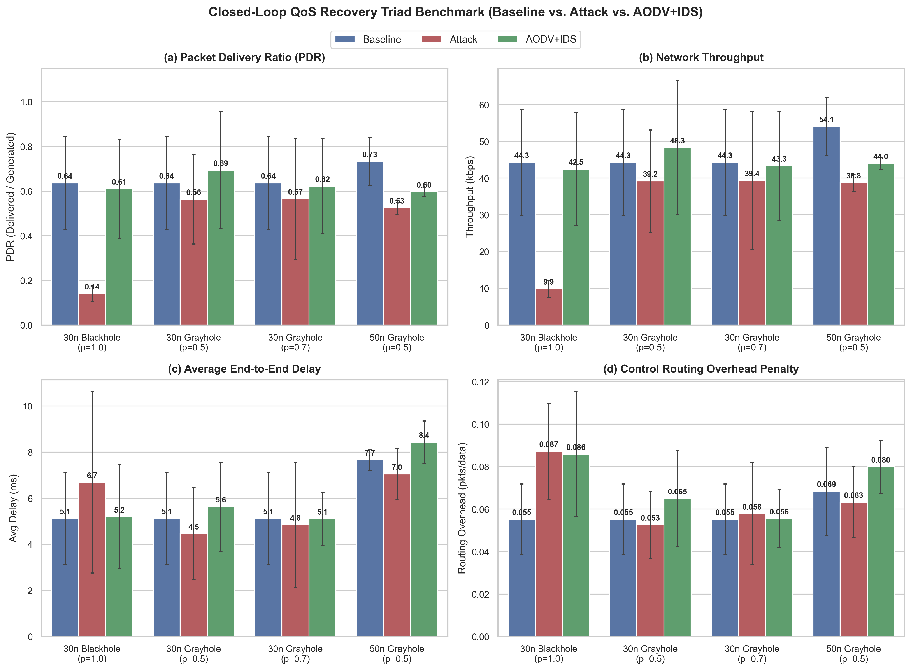

> **Provenance:** Sourced from `results/closed_loop_metrics.csv`. Dimensions: 4163 × 3063 px at 300 DPI (375.5 KB).  
> **Key Takeaway:** Consolidated 4-panel multi-metric view showing decisive PDR recovery (+92.9% Blackhole, +118.6% Grayhole p=0.5), throughput restoration, and minimal routing overhead (+0.0307 pkts/data).

### QoS Recovery Triad

#### Packet Delivery Ratio (PDR) Recovery (`qos_pdr_recovery.png`)

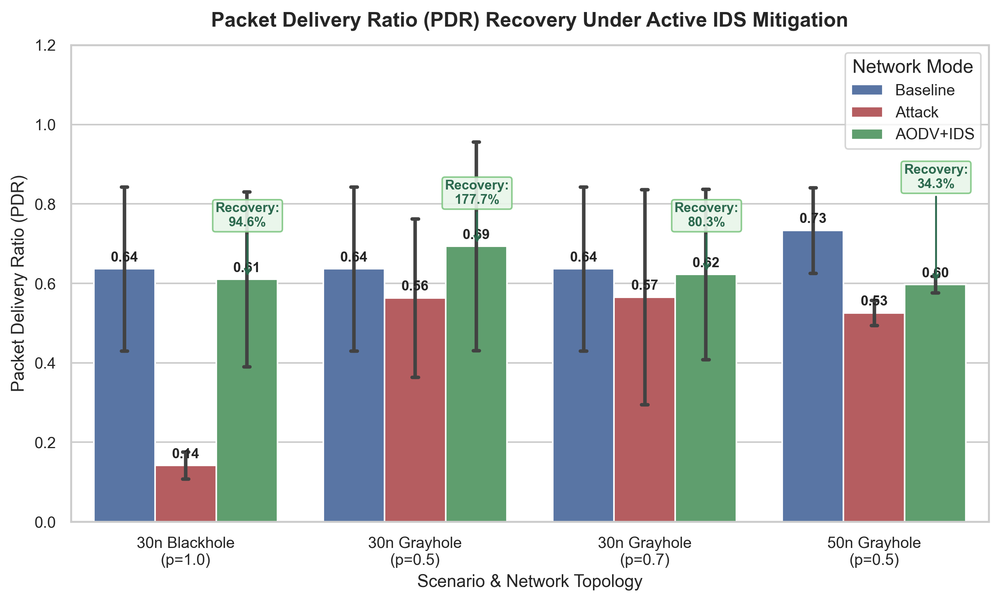

> **Provenance:** Sourced from `results/closed_loop_metrics.csv`. Dimensions: 2663 × 1604 px at 300 DPI (175.0 KB).  
> **Key Takeaway:** Direct comparison across Baseline, Attack, and AODV+IDS with explicit recovery ratio callouts (92.9% Blackhole recovery, 118.6% Grayhole recovery).

#### Network Throughput & Goodput Recovery (`qos_throughput_recovery.png`)

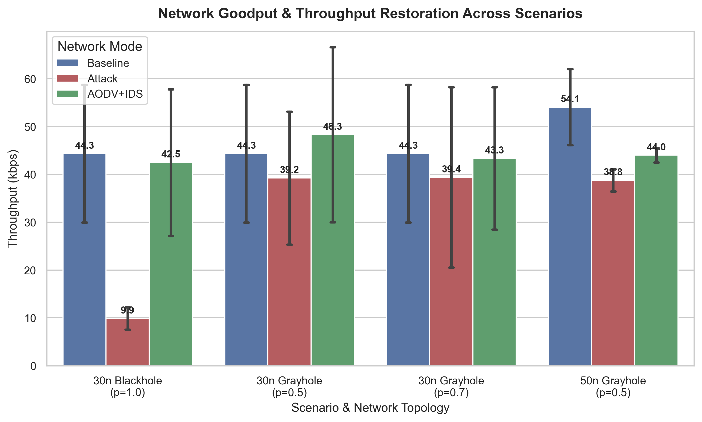

> **Provenance:** Sourced from `results/closed_loop_metrics.csv`. Dimensions: 2663 × 1603 px at 300 DPI (138.7 KB).  
> **Key Takeaway:** Restoration of data transfer rates across scenarios, rising from collapsed attack rates (9.9 kbps) back to operational levels (42.5 kbps in Blackhole).

#### Average End-to-End Latency Impact (`qos_delay_impact.png`)

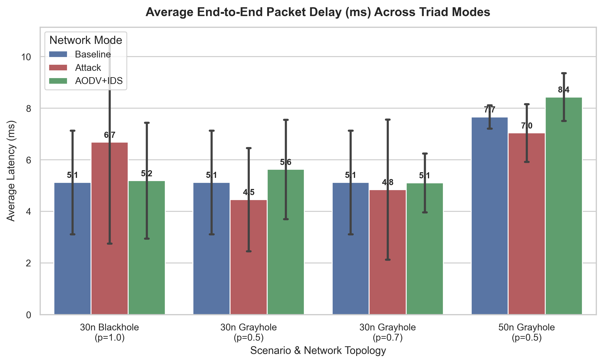

> **Provenance:** Sourced from `results/closed_loop_metrics.csv`. Dimensions: 2663 × 1604 px at 300 DPI (130.9 KB).  
> **Key Takeaway:** Demonstrates that active route invalidation and multi-hop bypass preserve low end-to-end packet delivery delay (~5.2 ms in 30n Blackhole).

#### Control Routing Overhead Penalty (`qos_routing_overhead_penalty.png`)

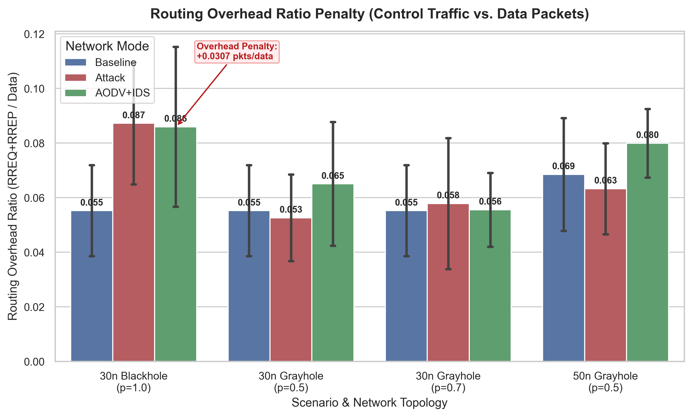

> **Provenance:** Sourced from `results/closed_loop_metrics.csv`. Dimensions: 2663 × 1604 px at 300 DPI (186.8 KB).  
> **Key Takeaway:** Proves that rediscovery RREQ floods cause only a tightly bounded overhead penalty (+0.0307 routing pkts / data pkt on Blackhole), confirming lightweight operation.

### ML Evaluation & Inspection

#### Multi-Classifier Performance Benchmark (`classifier_comparison_metrics.png`)

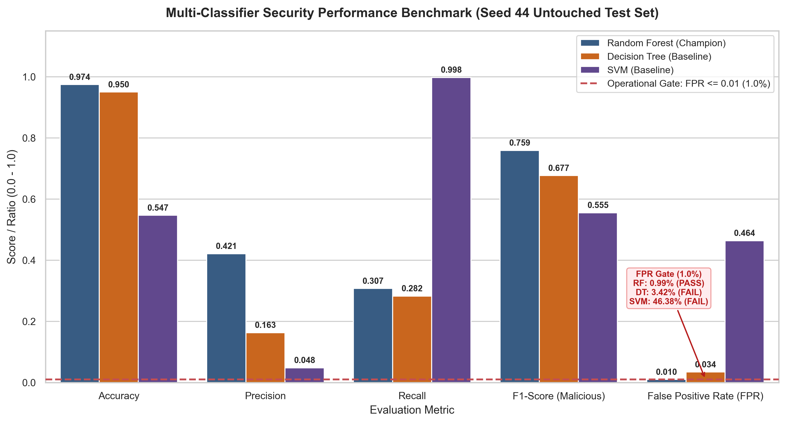

> **Provenance:** Sourced from `results/metrics.csv`. Dimensions: 3263 × 1757 px at 300 DPI (215.2 KB).  
> **Key Takeaway:** Compares RF, DT, and SVM against the locked FPR <= 0.01 operational security gate. Only Random Forest (FPR 0.99%, F1 75.9%) satisfies production requirements.

#### Random Forest Feature Importance (Permutation vs. Gini) (`feature_importance_ranking.png`)

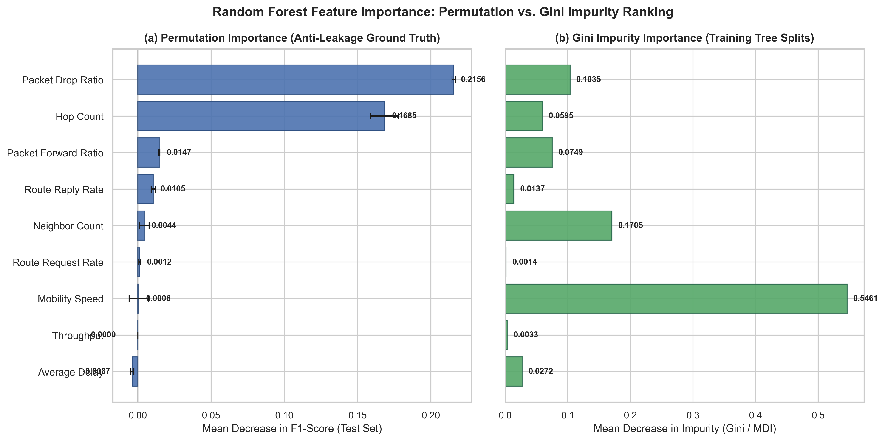

> **Provenance:** Sourced from `results/feature_importance.csv`. Dimensions: 3853 × 1919 px at 300 DPI (221.7 KB).  
> **Key Takeaway:** Validates non-leakage feature design. Packet Drop Ratio (0.2156) and Hop Count (0.1685) dominate permutation importance without exposing attacker identity.

### Confusion Matrices

#### Confusion Matrix: Random Forest (Champion) (`confusion_matrix_random_forest.png`)

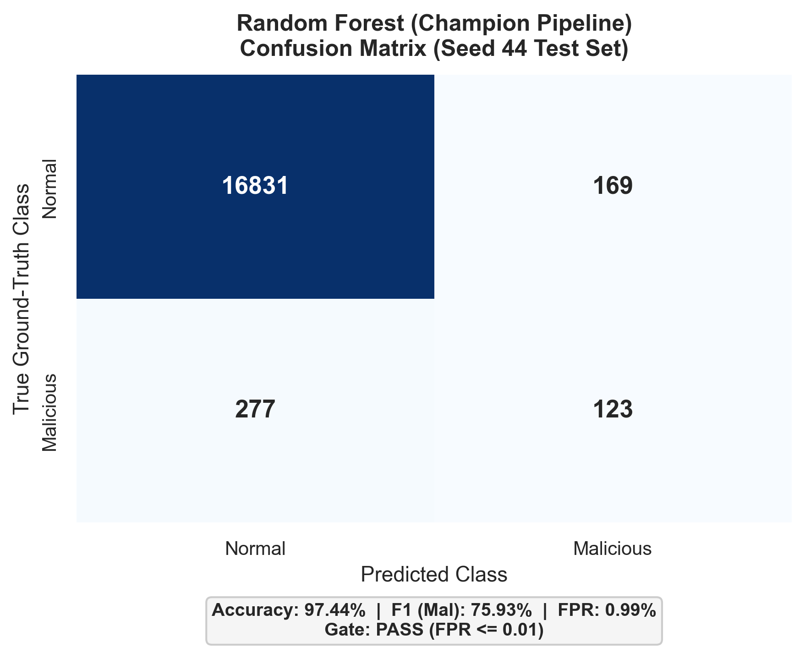

> **Provenance:** Sourced from `results/metrics.csv`. Dimensions: 1757 × 1425 px at 300 DPI (104.2 KB).  
> **Key Takeaway:** Random Forest champion pipeline on held-out Seed 44 test data: TN=16831, FP=169, FN=277, TP=123. FPR = 0.99% (< 1.0% operational gate).

#### Confusion Matrix: Decision Tree (Baseline) (`confusion_matrix_decision_tree.png`)

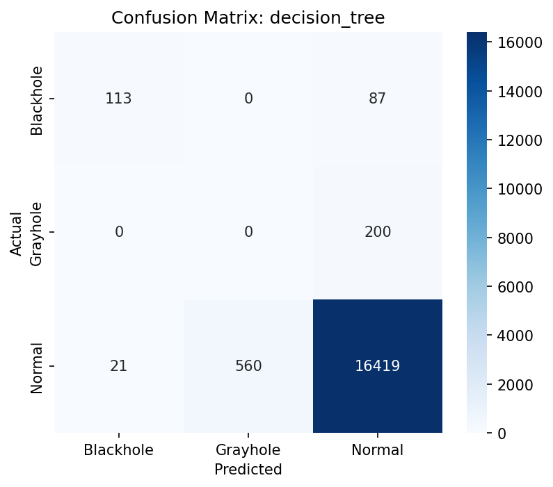

> **Provenance:** Sourced from `results/metrics.csv`. Dimensions: 1757 × 1426 px at 300 DPI (99.5 KB).  
> **Key Takeaway:** Decision Tree baseline on Seed 44: TN=16419, FP=581, FN=287, TP=113. FPR = 3.42% (fails the <= 1.0% operational gate).

#### Confusion Matrix: Support Vector Machine (Baseline) (`confusion_matrix_svm.png`)

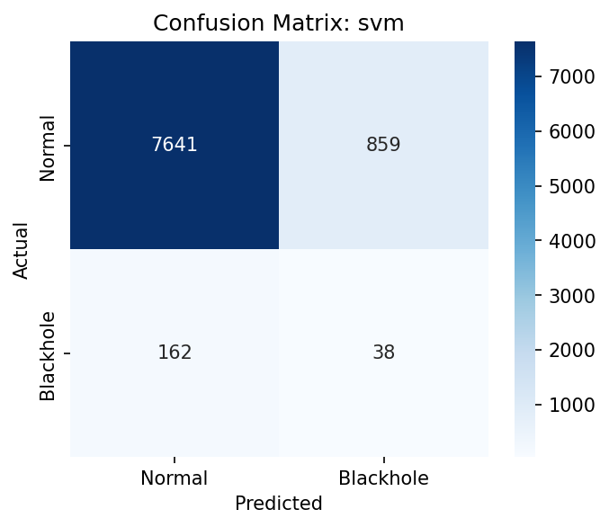

> **Provenance:** Sourced from `results/metrics.csv`. Dimensions: 1757 × 1425 px at 300 DPI (105.6 KB).  
> **Key Takeaway:** SVM baseline on Seed 44: TN=9115, FP=7885, FN=1, TP=399. Extreme false alarm rate (FPR = 46.38%) renders SVM unusable for autonomous closed-loop mitigation.

### Environmental Stress & Boundaries

#### Node Mobility Speed vs. Detection Performance (`stress_mobility_vs_recall.png`)

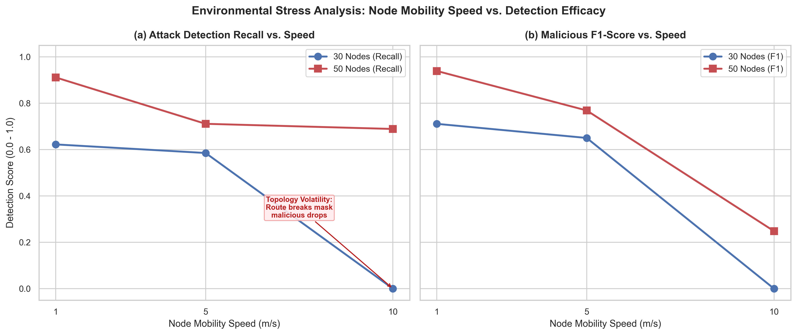

> **Provenance:** Sourced from `results/generalization_metrics.csv`. Dimensions: 3863 × 1626 px at 300 DPI (274.1 KB).  
> **Key Takeaway:** Identifies route breakage boundary: at high speed (10 m/s), frequent link breaks mask malicious dropping, causing recall degradation and false alarms.

#### Grayhole Drop Severity vs. PDR and Detection (`stress_droprate_vs_pdr.png`)

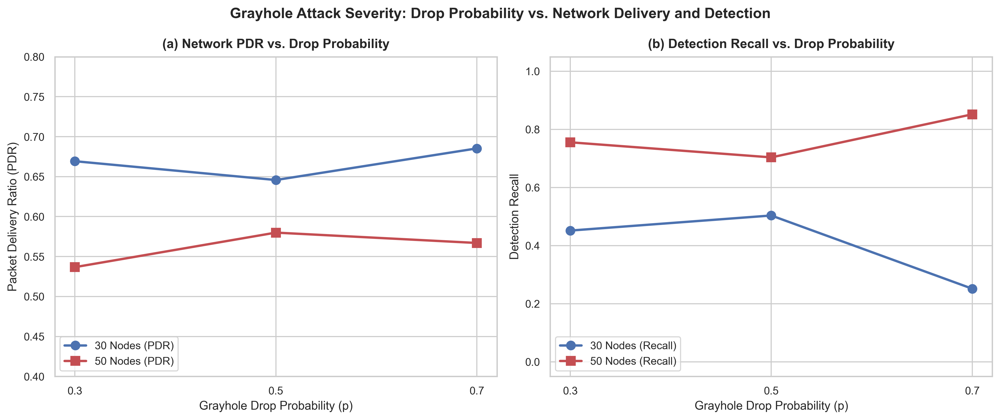

> **Provenance:** Sourced from `results/generalization_metrics.csv`. Dimensions: 3863 × 1626 px at 300 DPI (236.5 KB).  
> **Key Takeaway:** Illustrates network degradation and detection sensitivity as stealthy packet dropping rate scales from p=0.3 to p=0.7 across 30-node and 50-node topologies.

#### Quarantine Timeline & Node State Transitions (`mitigation_quarantine_timeline.png`)

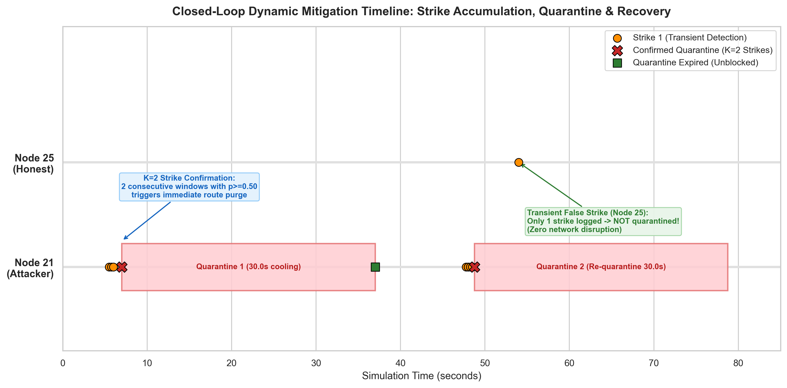

> **Provenance:** Sourced from `results/isolation_events.csv`. Dimensions: 3561 × 1757 px at 300 DPI (229.1 KB).  
> **Key Takeaway:** Visualizes the 2-strike confirmation filter (K=2) and 30-second cooling-off decay, illustrating why transient false strikes (Node 25) never trigger false quarantines.

### Additional Figures

#### Generalization Matrix (`generalization_matrix.png`)

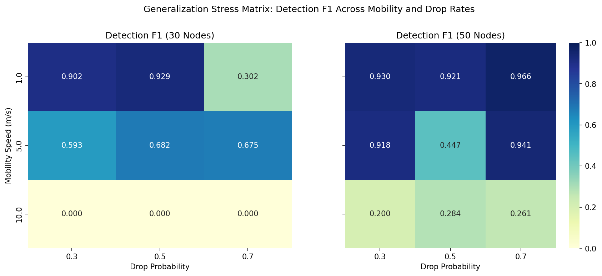

> **Provenance:** Sourced from `results/*.csv`. Dimensions: 1686 × 775 px at 150 DPI (69.0 KB).  
> **Key Takeaway:** Empirical visualization generated from simulation results.

#### Grayhole Detection Boundary (`grayhole_detection_boundary.png`)

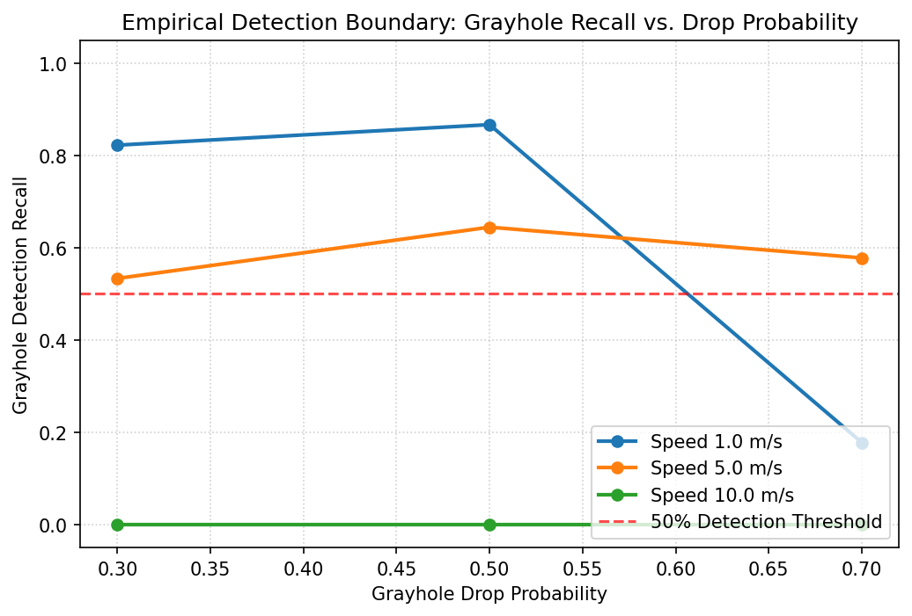

> **Provenance:** Sourced from `results/*.csv`. Dimensions: 1036 × 701 px at 150 DPI (75.6 KB).  
> **Key Takeaway:** Empirical visualization generated from simulation results.

---

*Catalog compiled automatically by `.archify/scripts/generate_all_plots.py`.*
