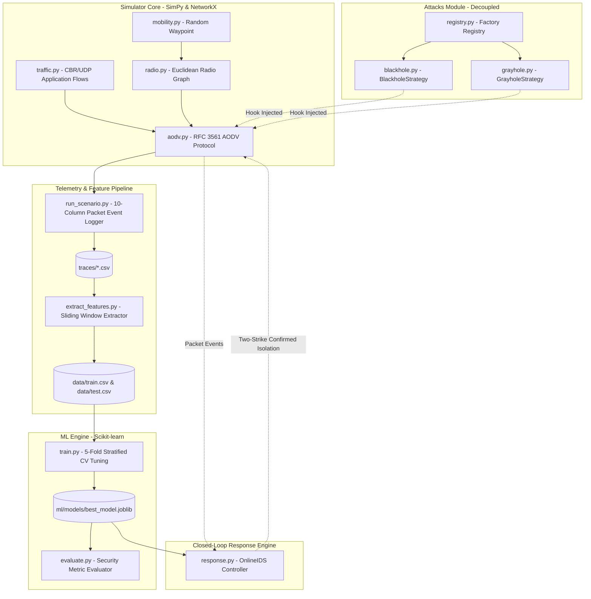

<!-- generated-by: gsd-doc-writer -->
# Architecture Overview

This document provides a comprehensive technical overview of the software architecture, design principles, component interactions, and data flow of the Machine Learning-Based Intrusion Detection and Response System for MANET.

## High-Level Overview

The system is designed as a modular, pure-Python pipeline replacing heavyweight C++ network simulators (such as NS-3) with a lightweight, deterministic discrete-event engine based on SimPy and NetworkX. The system operates in two distinct operational paradigms:

1. **Offline Training & Generalization Pipeline:**
   Runs simulated scenarios across independent seeds $\rightarrow$ outputs discrete packet event traces $\rightarrow$ extracts non-leaking sliding-window tabular features $\rightarrow$ partitions datasets strictly by seed/scenario $\rightarrow$ trains and validates cost-sensitive classifiers under a locked False Positive Rate gate ($\text{FPR} \le 1.0\%$).

2. **Online Closed-Loop Detection & Mitigation Pipeline:**
   Couples the serialized champion ML model directly to runtime network routing $\rightarrow$ feeds live packet events to an in-memory `OnlineIDS` controller $\rightarrow$ periodically infers node behaviors $\rightarrow$ applies a 2-strike confirmation filter $\rightarrow$ dynamically injects blacklist exclusions into RFC 3561 AODV routing nodes and purges poisoned routing entries.

## System Component Diagram

## Architectural Separation of Concerns

A fundamental architectural constraint is the strict decoupling between the simulator core and adversarial strategies:
- **Zero In-Tree Attack Imports:** The core simulator (`simulator/aodv.py`, `simulator/radio.py`, `simulator/traffic.py`) never imports from `attacks/`.
- **Runtime Strategy Hooking:** Attacker behaviors are injected at runtime via the composition root (`simulator/run_scenario.py`) using duck-typed strategy hooks on the `AODVNode` class:
  - `recv_rreq_hook(rreq)`: Intercepts incoming route requests to advertise falsified destination sequence numbers.
  - `forward_data_hook(packet)`: Intercepts transit data packets to silently drop them (unconditionally in Blackhole, selectively or probabilistically in Grayhole).
- **Clean Baselines:** Because attack logic is completely decoupled, running a scenario with zero attack strategies produces a mathematically pure, uncompromised baseline for rigorous QoS comparisons.

## Data Flow & Event Lifecycles

### 1. Packet Event Generation & Logging
1. Application CBR flows (`traffic.py`) enqueue UDP packets at regular intervals.
2. Source node issues an AODV Route Request (`RREQ`) if no valid route to destination exists.
3. Intermediate nodes broadcast the RREQ if within radio transmission range ($d \le R$).
4. The destination (or an attacker node spoofing a route) unicasts an AODV Route Reply (`RREP`) back along the reverse path.
5. All node packet events (`SEND`, `RECV`, `FWD`, `DROP`, `DATA_DROP`, `RREQ_DROP`) and periodic node state rows (`NODE_STATUS`) are appended to a CSV trace with a 10-column schema:
   `time, src, dst, pkt_id, type, hop_count, dropped_by, node_id, speed, neighbor_count`

### 2. Sliding-Window Feature Extraction
1. `feature_extraction/extract_features.py` divides the simulation duration into overlapping sliding windows $[t - W, t]$ with step size $S$ (default: $W = 10.0\text{ s}, S = 2.0\text{ s}$).
2. For each node active in window $w$, backward aggregation computes 9 non-leaking behavioral features:
   - `packet_forward_ratio`: Forwarded data packets / received data packets meant for forwarding.
   - `packet_drop_ratio`: Dropped data packets / received data packets meant for forwarding.
   - `avg_delay`: Mean latency between packet receipt and transmission.
   - `route_request_rate`: RREQs sent per second in window.
   - `route_reply_rate`: RREPs sent per second in window.
   - `throughput`: Total payload bytes successfully delivered or forwarded per second.
   - `hop_count`: Average hop count of forwarded traffic.
   - `neighbor_count`: Number of 1-hop reachable nodes.
   - `mobility_speed`: Current kinematic velocity in m/s.
3. Anti-Leakage Protocol: Feature matrix $X$ contains zero identity tags, coordinate positions, or oracle flags. Changing ground-truth attack labels leaves $X$ 100% numerically invariant.

### 3. Closed-Loop Online Mitigation Lifecycle
1. During active network operation, every node packet event is streamed to an in-memory sliding buffer in `OnlineIDS`.
2. Every $\Delta t = 5.0\text{ s}$, `OnlineIDS.step()` vectors current sliding statistics through the fitted `StandardScaler` and into the champion classifier.
3. **2-Strike Confirmation Filter:** To prevent benign route disruptions, an anomaly prediction must persist for $K=2$ consecutive evaluation windows before isolation is triggered.
4. **Dynamic Route Invalidation:** When node $m$ is isolated:
   - AODV node callback `is_blacklisted_cb(node_id)` marks node $m$ quarantined.
   - Future RREPs and RREQs from $m$ are dropped immediately.
   - `AodvNode.invalidate_routes_through(m)` purges all routing table entries listing node $m$ as next-hop or transit hop.
   - Active sources immediately trigger route rediscoveries, steering data packets along honest alternative multi-hop paths.
5. **Quarantine Decay:** Quarantined nodes remain isolated for a configurable decay window (default: 30.0 s), allowing transient congestion to clear without permanent network fragmentation.

## Key Abstractions

| Class / Component | Module Path | Responsibility |
|---|---|---|
| `SimulationRunner` | [simulator/run_scenario.py](file:///C:/Users/KIIT0001/Documents/projects/Machine%20Learning-Based%20Intrusion%20Detection%20System%20for%20MANET/simulator/run_scenario.py) | Scenario orchestrator, SimPy environment lifecycle, strategy injector, and trace recorder. |
| `AodvNode` | [simulator/aodv.py](file:///C:/Users/KIIT0001/Documents/projects/Machine%20Learning-Based%20Intrusion%20Detection%20System%20for%20MANET/simulator/aodv.py) | RFC 3561 AODV protocol implementation with sequence numbers, routing table expiry, and blacklist hook. |
| `RandomWaypointMobility` | [simulator/mobility.py](file:///C:/Users/KIIT0001/Documents/projects/Machine%20Learning-Based%20Intrusion%20Detection%20System%20for%20MANET/simulator/mobility.py) | 2D kinematic model calculating node velocity, waypoint targets, pause times, and coordinates. |
| `RadioModel` | [simulator/radio.py](file:///C:/Users/KIIT0001/Documents/projects/Machine%20Learning-Based%20Intrusion%20Detection%20System%20for%20MANET/simulator/radio.py) | Unit-disk propagation model maintaining dynamic NetworkX pairwise neighbor connectivity. |
| `TrafficGenerator` | [simulator/traffic.py](file:///C:/Users/KIIT0001/Documents/projects/Machine%20Learning-Based%20Intrusion%20Detection%20System%20for%20MANET/simulator/traffic.py) | Constant Bit Rate (CBR) UDP traffic flow generator scheduling discrete packet transmissions. |
| `AttackStrategy` | [attacks/base.py](file:///C:/Users/KIIT0001/Documents/projects/Machine%20Learning-Based%20Intrusion%20Detection%20System%20for%20MANET/attacks/base.py) | Abstract base class defining routing hook signatures for adversarial behavior injection. |
| `BlackholeStrategy` | [attacks/blackhole.py](file:///C:/Users/KIIT0001/Documents/projects/Machine%20Learning-Based%20Intrusion%20Detection%20System%20for%20MANET/attacks/blackhole.py) | Spoofs high destination sequence number in RREP and drops 100% of intercepted data packets. |
| `GrayholeStrategy` | [attacks/grayhole.py](file:///C:/Users/KIIT0001/Documents/projects/Machine%20Learning-Based%20Intrusion%20Detection%20System%20for%20MANET/attacks/grayhole.py) | Cooperates in AODV route discovery while selectively or probabilistically dropping data packets. |
| `OnlineIDS` | [ml/response.py](file:///C:/Users/KIIT0001/Documents/projects/Machine%20Learning-Based%20Intrusion%20Detection%20System%20for%20MANET/ml/response.py) | Real-time sliding window controller with 2-strike confirmation and quarantine route invalidation. |

## Directory Structure Rationale

- `simulator/`: Encapsulates all discrete-event networking code, ensuring that network protocol dynamics remain completely decoupled from machine learning code.
- `attacks/`: Contains independent attack strategy implementations. Top-level placement enforces the architectural rule that the simulator never imports attack logic directly.
- `feature_extraction/`: Isolated preprocessing module converting raw packet events into ML-ready tabular datasets.
- `ml/`: Model training, evaluation, persistence, generalization analysis, and online mitigation controllers.
- `scenarios/`: Declarative JSON configurations decoupling experiment parameters (node counts, velocities, packet rates) from executable code.
- `scripts/`: Authoritative benchmark drivers for automated dataset generation, cross-scenario generalization testing, and 3-way QoS evaluation.
- `tests/`: Comprehensive pytest verification suite ensuring mathematical determinism and protocol correctness.
- `docs/`: Technical manuals, getting started guides, and formal academic thesis documentation.
